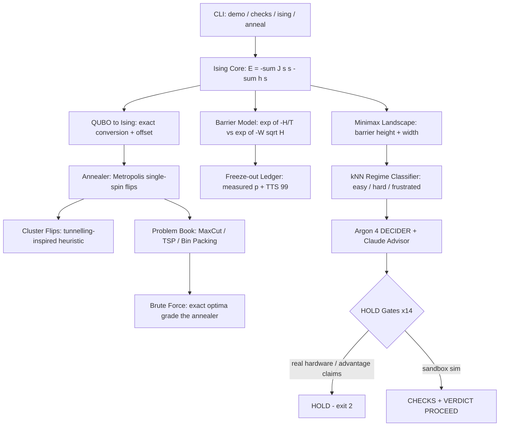
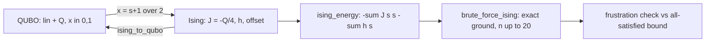
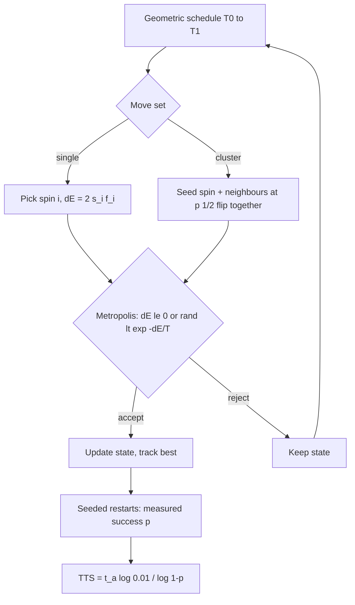
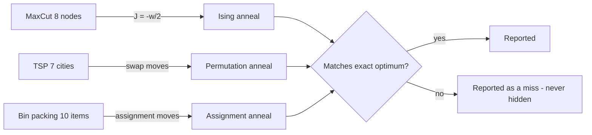
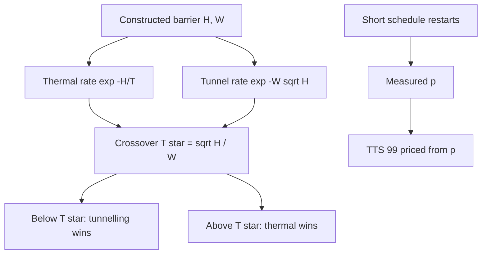
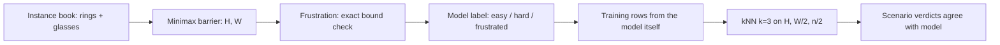
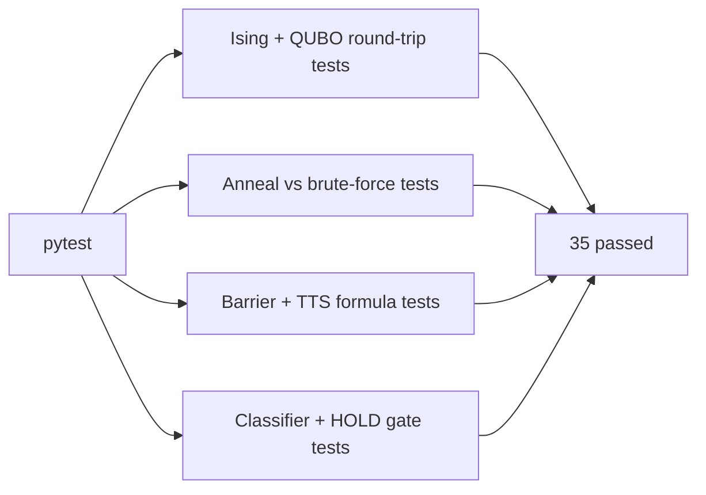
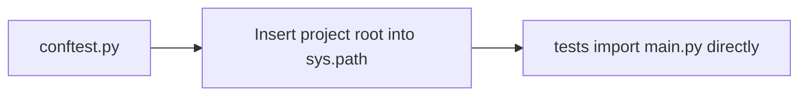
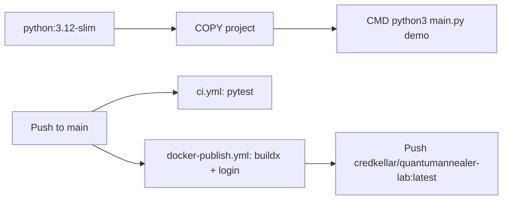

# QuantumAnnealer-Lab 🌡️⚛️

**Quantum Annealing Optimization Lab** — by Darion Kellar

QuantumAnnealer-Lab is an **educational quantum annealing lab** in ONE pure-Python file — and the first thing it teaches is what it is **not**:

- **Not quantum hardware.** No annealer is run, submitted to, or simulated here. Every "anneal" is a **classical simulation** on an ordinary CPU.
- **Not a quantum-advantage claim.** The cluster-flip move set is a classical heuristic **inspired by tunnelling** — many spins flip together, the way a tunnelling event would carry a state *through* a barrier instead of over it. It wears a tunnelling costume and the lab says so everywhere it appears.

What IS real here is the modelling: the Ising energy `E = -sum(J_ij s_i s_j) - sum(h_i s_i)`, an **exact QUBO ↔ Ising conversion** asserted to round-trip on every state, simulated annealing with Metropolis single-spin flips on a geometric schedule, the **two barrier laws** (thermal escape pays for barrier *height*, `exp(-H/T)`; tunnelling pays for *width × √height*, `exp(-W·√H)`), a freeze-out ledger that prices **time-to-solution from a measured success probability**, and three small problems — MaxCut, toy TSP, bin packing — each solved **exactly by brute force** so the annealer is only believed where it matches the truth. 🔬

Honest scope, stated up front: hardware figures for D-Wave-class annealers are **labelled published-class reference values**, printed for scale and never measured here. Every real-hardware / live-service / advantage claim sits behind a permanent HOLD gate (14 total). 🔒

[](https://github.com/kimanicollier44-cmyk/QuantumAnnealer-Lab/actions/workflows/ci.yml)
[](https://github.com/kimanicollier44-cmyk/QuantumAnnealer-Lab/actions/workflows/docker-publish.yml)

> ℹ️ These are the **live** workflow badges for this repo. They activate as soon as the `ci.yml` and `docker-publish.yml` files from the paste pack are pasted into `.github/workflows/` — until then they have nothing to report yet.

## 🧰 Tech Stack Badges & Full Architecture Tech Stack

### 💻 Core Programming Languages & Core Systems


- 🐍 Python 3.12, pure standard library (`math`, `random`, `itertools`, `heapq`, `hashlib`, `json`, `sys`) — zero dependencies, zero network, deterministic (double-run byte-identical)
- 🧲 Ising core: `E = -sum(J_ij s_i s_j) - sum(h_i s_i)` with the exact QUBO ↔ Ising conversion (`J = -Q/4`, offset tracked) — energies asserted equal on all 32 states of the demo QUBO, round-trip asserted exactly
- 🌡️ Annealing engine: Metropolis single-spin flips with the exact local-field delta `2·s_i·f_i`, geometric temperature schedules, seeded restarts, and the cluster-flip (tunnelling-inspired) move set
- 🧠 TinyML kNN regime classifier (from scratch, stdlib): easy / hard / frustrated from the exact minimax landscape barrier (height, width, problem size)
- 🪑 Council seats: Gemini Argon 4 DECIDER (names-only, tighten-only) + Muse advisor (never overrides HOLD) + Google Flow plan-only (rendered = False, live = 0)

### ⛓️ Web3 & Infrastructure

- 🚫 **Not applicable — honestly.** No blockchain, no Web3, no tokens: the "infrastructure" in this lab is a labelled simulation of energy landscapes inside one offline file. No fake badges here.

### ⚙️ Platform Support & Hardware Architecture


- 🖥️ Pure Python — runs anywhere Python 3.12+ runs (Linux, macOS, Windows, any CPU), plus the `python:3.12-slim` Docker image
- 🔒 No quantum hardware is controlled or submitted to, ever: real annealers and QPU services are permanent HOLD gates (see the gate table below). The D-Wave-class rows in the hardware table are labelled published-class references, not interfaces.

### ⚡ Low-Level Infrastructure & Performance

- 🚫 **No low-level code — honestly.** No C, no C++, no GPU, no compiled extensions: this is one interpreted Python file on purpose, so every number can be read, checked, and diffed. Performance here means honest algorithms — exact local-field flip deltas instead of full energy recomputation, a Dijkstra minimax walk for the landscape barrier, brute force capped at n ≤ 20 (landscape n ≤ 12) with the caps stated in the code.

### 🛠️ DevOps & Build Tools


- 🐳 Docker (`python:3.12-slim`), GitHub Actions CI + Docker Publish (delivered in the paste pack)
- 🎯 Target image: `credkellar/quantumannealer-lab:latest`
- 🧪 Tests: `pytest` (35 tests) + the built-in CHECKS suite (47 checks) in `main.py`

### ☁️ Cloud Providers

- 🚫 **None — honestly.** No cloud provider is used or needed: the lab runs fully offline on your own machine or in a local Docker container. Docker Hub appears only as the registry the publish workflow pushes the image to. (Cloud QPU services exist in the real world; submitting to one from here is a HOLD gate, not a feature.)

## What this does?

1. 🎯 **The honest core, first** — the demo opens by stating what the lab is not: no quantum hardware, no submissions, no advantage claim. The cluster-flip moves are introduced as what they are — a classical heuristic inspired by tunnelling — before they are ever run.
2. 🧲 **Ising core** — the energy `E = -sum(J_ij s_i s_j) - sum(h_i s_i)` over spins `s ∈ {-1, +1}`, with local fields `f_i = sum_j J_ij s_j + h_i` and frustration checked exactly: a ground state above the all-satisfied bound `-sum|J| - sum|h|` proves some couplings must lose.
3. 🔁 **QUBO ↔ Ising, exact** — substituting `x = (s + 1)/2` gives `J_ij = -Q_ij/4` and `h_i = -(lin_i/2 + (1/4)·sum Q_ij)` plus a constant offset. The demo QUBO (5 variables, offset −0.9793) matches energies on **all 32 states**, and converting Ising → QUBO → Ising returns the original model to 1e-9 — asserted in CHECKS, not assumed.
4. 🌡️ **Simulated annealing** — Metropolis single-spin flips (delta computed exactly as `2·s_i·f_i`) on a geometric schedule from T = 2.5 to 0.02 over 20,000 steps, seeded end to end: the same seed reproduces the same run, bit for bit.
5. 🌀 **Cluster flips (tunnelling-inspired)** — a seed spin plus each neighbour with probability ½ flips as one region. On the demo spin glass both move sets reach the exact ground energy **−18.0** — and the lab reports that as a tie on a 12-spin toy, not as evidence about real tunnelling.
6. ✂️ **MaxCut, graded** — the 8-node book graph (14 edges, total weight 26) becomes an Ising model with `J = -w/2`; brute force finds the optimal cut **20** (partition {2, 3, 7}), and both annealers match it exactly.
7. 🗺️ **Toy TSP, graded** — 7 labelled cities annealed in their native permutation space (swap moves): annealer **25.1429** = brute-force optimum **25.1429**. The QUBO encoding would need 7² = 49 spins — the lab states that instead of hiding it.
8. 📦 **Bin packing, graded** — items [8, 7, 6, 5, 4, 4, 3, 3, 2, 2] into bins of 10: lower bound 5 bins, first-fit-decreasing uses 5, and the assignment annealer (energy prices bins used + overflow) also finds 5 — optimal, proven against the bound.
9. ⛰️ **The barrier model** — a constructed barrier (H = 4, W = 3): thermal rate `exp(-H/T)` vs tunnelling rate `exp(-W·√H)` = `exp(-6)`. They cross at **T\* = √H/W = 0.6667**: at T = 0.5 the tunnelling rate (2.479×10⁻³) beats thermal (3.355×10⁻⁴); at T = 2.0 thermal wins. Height is the thermal bill; width × √height is the tunnelling bill.
10. 🧊 **Freeze-out + time-to-solution** — a deliberately short schedule (120 steps) lands on the ground state in **15 of 20** seeded restarts (p = 0.75), so its TTS(99%) = 120 · log(0.01)/log(0.25) ≈ **399 steps**; the full schedule goes 20/20 (p = 1.0). TTS is priced from the measured p — never from the luckiest run.
11. 🏷️ **Hardware table + classifier + seats + checks** — D-Wave-class rows (2000Q ≈ 2,048 qubits Chimera · Advantage ≈ 5,760 Pegasus · Advantage2 ≈ 4,400 Zephyr) all flagged **LABELLED published-class, not measured**, next to the lab's own honest row ("12-spin demo instance — a CPU simulation"). A from-scratch kNN labels landscapes easy / hard / frustrated from their exact minimax barriers (ring-8 easy, ring-12 hard, demo glass frustrated), with Argon 4 DECIDER (sha256 trace), Muse advisor, Google Flow plan-only, and a built-in CHECKS suite (47 checks).

## 🗺️ How it works — diagram per script

### `main.py` — the whole lab



### Ising / QUBO subsystem



### Annealing engine



### Problem book — everything graded by brute force



### Barrier model + freeze-out



### Regime classifier



### `tests/test_main.py` — verification



### `conftest.py` — test path setup



### `Dockerfile` + CI flow — container & publish



## Why is this cool?

1. 🎯 The honesty is the headline feature: the lab's first output section is a list of what it is **not** — no hardware, no submissions, no advantage claim — and those aren't disclaimers in fine print, they're enforced HOLD gates with exit code 2.
2. 🔁 The QUBO ↔ Ising conversion is **proven, not asserted**: energies match on all 32 states of the demo QUBO and the round-trip returns the original model to 1e-9. Most explainers just print the formulas.
3. ⚖️ Every heuristic number is **graded by an exact one**: MaxCut 20, TSP 25.1429, spin-glass ground −18.0, bin packing at its lower bound — the annealer is believed exactly where brute force agrees, and the lab says a miss would be reported as a miss.
4. ⛰️ The two barrier laws are made **visible in one table**: at T = 0.5 tunnelling's 2.479×10⁻³ beats thermal's 3.355×10⁻⁴; at T = 2.0 the order flips — with the crossover T\* = √H/W computed, not quoted.
5. 🌀 The cluster flip lets you *feel* the tunnelling idea classically: a whole region of the state moves at once, and on the demo glass it ties single-spin annealing at the exact ground energy — reported as a tie on a toy, which is the honest result.
6. 🧊 Freeze-out is measured, not narrated: the short schedule's p = 0.75 comes from 20 seeded restarts, and its TTS(99%) of ≈ 399 steps is *derived* from that p with the field's own formula.
7. 🧱 Frustration is checked **exactly** — the ground state is compared against the all-satisfied bound, so "this instance is frustrated" is a theorem about the instance, not a vibe.
8. 🏷️ The hardware table labels itself: D-Wave-class spec numbers sit in rows flagged LABELLED next to the lab's own row, which reads "12-spin demo instance — a CPU simulation, NOT a quantum annealer."
9. 🗺️ The classifier's training data is generated by the lab's own landscape machinery — exact minimax barriers from Dijkstra walks over the state graph — so the kNN interpolates a model you can audit line by line.
10. 🎯 Deterministic end to end: run it twice, get byte-identical output — an annealing lab you can diff.

## What problems this solves?

1. ❌ **Problem:** "Quantum annealing" demos quietly imply a real QPU is involved. ✅ **Solution:** The first demo section and the `real_hardware_control` / `live_hardware_submission` HOLD gates state and enforce that this is a classical simulation — nothing is run or submitted anywhere.
2. ❌ **Problem:** Cluster-flip and "quantum-inspired" heuristics get marketed as tunnelling. ✅ **Solution:** The move set is labelled a classical heuristic inspired by tunnelling in the docstring, the demo, the README, and its own HOLD gate (`tunnelling_overclaim`).
3. ❌ **Problem:** QUBO ↔ Ising conversions are usually printed without proof and sign errors are endemic. ✅ **Solution:** Both directions are implemented with the offset tracked, energies asserted equal on every state of a random instance, and the round-trip asserted exactly.
4. ❌ **Problem:** Annealer results are reported against other heuristics, so nobody knows the true optimum. ✅ **Solution:** MaxCut, TSP, bin packing, and the spin glass all carry brute-force optima (or a proven lower bound), and the annealer's score is printed next to them.
5. ❌ **Problem:** "Thermal vs quantum" is explained with adjectives instead of numbers. ✅ **Solution:** The barrier model computes both rates on one constructed landscape and derives the crossover temperature T\* = √H/W where the winner flips.
6. ❌ **Problem:** Time-to-solution gets quoted from the single luckiest run. ✅ **Solution:** Success probability is measured over seeded restarts and TTS(99%) is computed from that measured p with the standard formula — the short schedule's freeze-out is priced honestly at ≈ 399 steps.
7. ❌ **Problem:** Vendor qubit counts get repeated as if they were benchmarks. ✅ **Solution:** Every hardware row is flagged LABELLED published-class with "not measured" in the row, and `benchmark_fabrication_claim` is a permanent HOLD gate.
8. ❌ **Problem:** "Hard instance" is usually a feeling. ✅ **Solution:** The exact minimax barrier (height + width) and the exact frustration check turn hardness into two numbers and a theorem, and the classifier's labels come from those numbers.
9. ❌ **Problem:** TSP's QUBO encoding cost (n² spins) is hidden in annealing tutorials. ✅ **Solution:** The lab anneals TSP in permutation space and states plainly that the QUBO form of its 7-city toy would need 49 spins.
10. ❌ **Problem:** Simulation tools quietly imply a service, a speedup, or a product is next. ✅ **Solution:** 14 named HOLD gates return exit code 2 for every hardware, service, financial, logistics, and advantage claim, forever.

## How to install this?

1. 📋 Clone or download this project folder:

```bash
git clone https://github.com/kimanicollier44-cmyk/QuantumAnnealer-Lab.git
```

2. 🐍 Make sure Python 3.12+ is installed: `python3 --version`
3. ▶️ Run the full demo + checks (no arguments needed):

```bash
python3 main.py
```

4. 🧪 Run the test suite:

```bash
pip install pytest
python3 -m pytest -q
```

5. 🎛️ Try the other commands:

```bash
python3 main.py checks    # 47 built-in checks
python3 main.py ising     # demo QUBO -> Ising conversion + ground state
python3 main.py anneal    # spin glass: SA vs cluster vs brute force
python3 main.py maxcut    # MaxCut report, graded by brute force
python3 main.py tsp       # toy TSP report, graded by brute force
python3 main.py barrier   # thermal vs tunnelling rates + crossover
python3 main.py tts       # freeze-out ledger + time-to-solution
python3 main.py classify  # kNN regime classifier report
python3 main.py brains    # Argon 4 + Muse + Flow seats
python3 main.py holds     # list all 14 HOLD gates
python3 main.py hold-demo # exits 2 - gated actions stay HOLD
```

6. 🐳 Or run it in Docker:

```bash
docker build -t credkellar/quantumannealer-lab:latest .
docker run --rm credkellar/quantumannealer-lab:latest
docker pull credkellar/quantumannealer-lab:latest
```

## Requirements

- 🐍 Python 3.12 or newer
- 📦 Dependencies: **none** (standard library only)
- 🌐 Network: **none** — fully offline
- 🧪 For tests only: `pytest`
- 🐳 Optional: Docker

## FULL project structure tree

```text
quantumannealer-lab/
├── main.py                  # the whole lab: Ising/QUBO core, SA + cluster annealer, MaxCut/TSP/bin packing, barrier model, TTS ledger, hardware table, classifier, seats, HOLD gates
├── conftest.py              # puts the project root on sys.path for tests
├── tests/
│   └── test_main.py         # 35 pytest tests: Ising/QUBO round-trip, anneal vs brute force, barrier + TTS, classifier, gates, determinism
├── assets/
│   └── cover.png            # README cover image (2736 x 912)
├── Dockerfile               # python:3.12-slim, runs the demo
├── .gitignore               # __pycache__/, .pytest_cache/, *.pyc
└── README.md                # this file
```

> 📦 Delivered separately as paste packs (not in this tree): `.github/workflows/ci.yml` + `docker-publish.yml`, and the Docker Hub pack (100-char description, 350-char About, overview, categories).

## 🔒 HOLD gates — all 14, permanent

| # | Gate | What stays held |
|---|------|-----------------|
| 1 | `real_hardware_control` | No control of any real quantum annealer or QPU, ever |
| 2 | `live_hardware_submission` | No submitting jobs to real quantum hardware or cloud QPU services |
| 3 | `quantum_advantage_claim` | A classical simulation demonstrates no quantum advantage, and none is claimed |
| 4 | `tunnelling_overclaim` | Cluster flips are a classical heuristic inspired by tunnelling; no real tunnelling is performed |
| 5 | `commercial_optimization_service_claim` | No commercial optimization service exists here; this is an educational simulator |
| 6 | `live_logistics_optimization` | No routing, scheduling, or logistics decisions for real operations from a sim |
| 7 | `financial_optimization_claim` | No portfolio, trading, or financial optimization advice of any kind |
| 8 | `guaranteed_optimum_claim` | Annealing is a heuristic; no run is guaranteed to find the global optimum |
| 9 | `benchmark_fabrication_claim` | Labelled published-class hardware values are never presented as measured benchmarks |
| 10 | `critical_infrastructure_optimization` | No optimization of real power grids or critical infrastructure operations |
| 11 | `medical_claim` | No medical, treatment-planning, or drug-design optimization claims |
| 12 | `investment_claim` | No investment advice about quantum computing or annealing companies |
| 13 | `weapons_application_claim` | No weapons application guidance of any kind |
| 14 | `remove_human_override` | The human override is never removed; a person can always stop the sim |

🧑‍⚖️ **Council seats:** Gemini Argon 4 Extended Thinking — DECIDER (names-only, tighten-only, MAP → MODEL → STRESS → DECIDE, sha256 trace, `can_override_hold = False`) · Muse — advisor (`can_override_hold = False`) · Google Flow — plan-only (`rendered = False`, `live = 0`).

✅ **Verification:** pytest **35 passed** (project + clean copy) · built-in CHECKS **47/47** · double-run output **byte-identical** · `hold-demo` exits **2** · `main.py` **1,155 lines**, pure stdlib, zero network.

## 🧒 5th-grade English section

Imagine a bowl of marbles on a bumpy table, and you want all the marbles to roll to the lowest spot. 🥣

- The bumps are like hills between valleys. To get from one valley to a lower one, a marble first has to climb **up** a hill. That climb is the hard part, and this lab measures exactly how tall and how wide each hill is.
- **Simulated annealing** is like gently shaking the table. Early on you shake hard, so marbles hop over hills and explore. Then you shake less and less, and the marbles settle into the deepest valley they found. Shaking is heat — and heat pays for the **height** of the hill.
- Real quantum annealers use a trick called **tunnelling**: instead of climbing over a thin hill, a quantum marble can slip **through** it. Tunnelling pays for the **width** of the hill instead. This lab does not have a real quantum machine — it pretends, with a move that flips a whole group of spins at once, and it tells you clearly that this is pretend.
- How do we know the pretend annealer did a good job? For small puzzles, the lab checks **every single answer** one by one (that's called brute force) and compares. It's like checking your homework against the answer key — only believing the grade when they match. ✔️
- Sometimes the shaking stops too early and the marbles freeze in a not-quite-lowest valley. The lab counts how often that happens and honestly reports it, instead of only showing the luckiest try.
- This project is a **pretend lab on a computer**. It controls no real quantum machine and proves no quantum speedup. It helps you learn why finding the lowest valley is easy to say and hard to do. 💻

---

MIT © 2026 Darion Kellar · QuantumAnnealer-Lab — educational simulation only 🌡️
